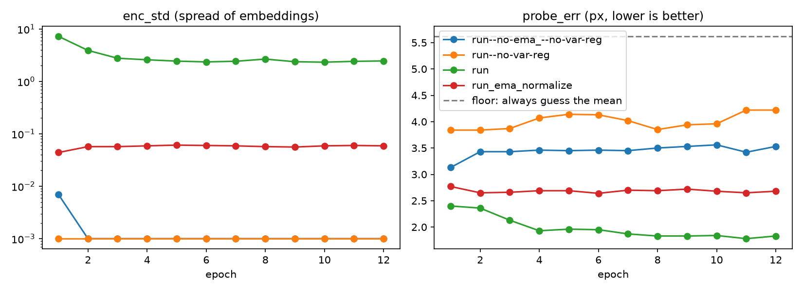

# toy-jepa


## What a JEPA is  
JEPA Joint Embedding Predictive Architecture is a non generative SSL architecture that learns by predicting a part of the input from another one (future from current state or masked from visible) in a higher level embedding space that allows to drop anything that is unpredictable instead of predicting every pixel. The hope is that this type of model would be able to focus on semantic structures and learn abstract physics concepts from observation. The architecture consists of a context encoder, a target encoder and a predictor. It is usually evaluated with a probe to assess usefulness of encodings. Here we use frames 0-3 of two bouncing objects to predict embeddings of frames 8-11, and the probe reads the largest shape's position at frame 3 from the encoding of frames 0-3.

The difficulty with a model like JEPA is to avoid collapse to the obvious solution of a constant embedding for all inputs for both the context and target encoders. Methods like EMA on target encoder, Normalization, VICReg, more recently SIGReg are tested to prevent collapse and achieve more useful encodings.

## The four variants 

In this repo I am testing EMA, Variance Regularization and Normalization. All with stop-grad.
Common: encoder, predictor, frames 0-3 as input, frames 8-11 as target, stop gradient on target
1. neither: only one encoder for context and target, with stop gradient on the target side
2. EMA only: target encoder is slow moving copy, updated at the rate of 0.01 from the context encoder
3. EMA + variance term: in addition to EMA, we add a variance term to the loss that penalizes features with a low variance (below 1) across the batch
4. EMA + normalize: in addition to EMA, prediction and target encodings are scaled to length 1 in the loss calculation

## Results  

| variant | flags | final loss | final enc_std | final probe_err |
|---|---|---|---|---|
| 1: neither | `--no-ema --no-var-reg` | 0.0000 | 0.001 | 3.53 px |
| 2: EMA only | `--no-var-reg` | 0.0000 | 0.001 | 4.22 px |
| 3: EMA + variance term | (default) | 0.6708 | 2.462 | **1.83 px** |
| 4: EMA + normalize | `--no-var-reg --normalize` | 0.0000 | 0.059 | 2.68 px |

Baselines on the same data: always predicting the mean position 5.62 px, an untrained encoder about 3.0 px.



## What I found  
1. In rows 1 and 2 the loss was 0 and that was the bad case (collapse), while the healthy run never reached loss 0, so the loss alone can't tell us everything.
2. EMA alone didn't prevent collapse. EMA is usually not used alone.
3. Normalizing avoided the fast solution of shrinking to 0 but does not stop all embeddings pointing in the same direction, since the loss ignores size.
4. Fully collapsed runs were worse than an untrained encoder, 3.53px and 4.22px vs 3.0px in probe_err.

## How to run 
```bash
pip install torch numpy matplotlib
mkdir -p logs

python train_jepa.py --epochs 12 --no-ema --no-var-reg     | tee "logs/run--no-ema_--no-var-reg.txt"   # 1: neither
python train_jepa.py --epochs 12 --no-var-reg              | tee "logs/run--no-var-reg.txt"            # 2: EMA only
python train_jepa.py --epochs 12                           | tee "logs/run.txt"                        # 3: EMA + variance term
python train_jepa.py --epochs 12 --no-var-reg --normalize  | tee "logs/run_ema_normalize.txt"          # 4: EMA + normalize

python plot_runs.py   # reads the four logs in logs/, writes collapse.png
```
About 9 minutes per run on an M4 Pro (MPS). Each run prints one row per epoch: loss, `enc_std` (spread of the embeddings across a batch), `probe_err` (pixels of error when a ridge probe reads the largest shape's position from the frozen embeddings).

## Honest note  
Built as self-study. The dataset generator (`bouncing_shapes.py`) was generated with Claude. `jepa.py` and `train_jepa.py` started as exercise skeletons, also generated with Claude: the conv encoder, the argument parsing, the data loading and the docstrings. I wrote the predictor, the target encoder and its EMA update, the forward pass, the two loss terms, the training step, the probe, the `--normalize` variant and the log parser in `plot_runs.py` (its matplotlib calls were written with an assistant). The logs in `logs/` are the runs behind the table.
